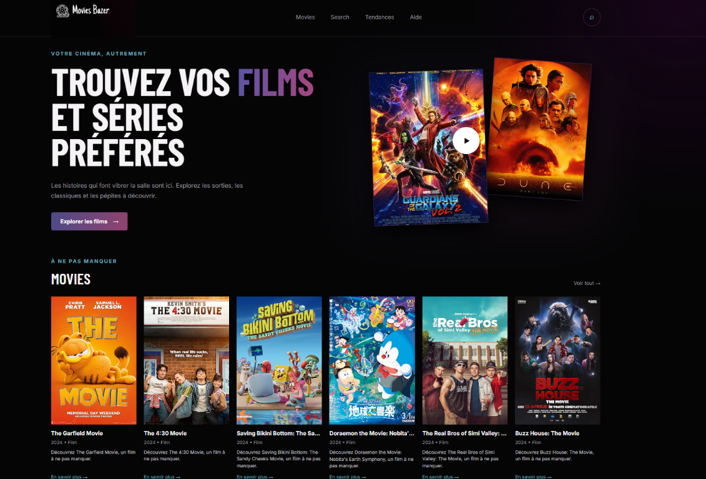

# Movies Bazar

Movies Bazar est un site web statique en français consacré à la découverte de films. Il permet de parcourir les films tendance, de rechercher un titre ou un acteur et de consulter une fiche détaillée.



## Fonctionnalités

- Page d’accueil avec présentation du site et sélection de films.
- Page **Tendances** avec affichage progressif des films disponibles.
- Recherche par titre ou par acteur.
- Recherche en ligne avec l’API [OMDb](https://www.omdbapi.com/) lorsqu’une clé API est configurée.
- Mode de secours local avec une sélection de films intégrée au projet.
- Fiches détaillées accessibles depuis chaque carte de film.
- Formulaire de signalement disponible depuis la page **Aide**.
- Interface responsive adaptée aux écrans mobiles et desktop.

## Technologies utilisées

- HTML5
- CSS3
- JavaScript côté client, sans framework
- API OMDb pour les recherches et les détails des films
- Web3Forms pour l’envoi du formulaire d’aide
- Google Fonts : Inter et Barlow Condensed

## Lancer le projet

Le projet ne nécessite ni compilation ni installation de dépendances.

### Option 1 : ouvrir directement le fichier HTML

Ouvrez [`index.html`](index.html) dans un navigateur.

### Option 2 : utiliser un serveur local

Depuis le dossier du projet, lancez un serveur HTTP statique. Par exemple, avec Python :

```bash
python -m http.server 8000
```

Puis ouvrez [http://localhost:8000](http://localhost:8000) dans votre navigateur.

L’utilisation d’un serveur local est recommandée pour obtenir un comportement identique à celui d’un hébergement web.

## Configuration de l’API OMDb

Par défaut, le site fonctionne avec les données locales définies dans [`js/data.js`](js/data.js). Pour activer les recherches et les fiches détaillées depuis OMDb :

1. Obtenez une clé API sur [omdbapi.com](https://www.omdbapi.com/apikey.aspx).
2. Ouvrez [`js/config.js`](js/config.js).
3. Renseignez la propriété `apiKey` :

```js
window.MOVIES_CONFIG = {
    apiKey: "VOTRE_CLE_OMDB",
    // ...
};
```

Ne publiez pas une clé API réelle dans un dépôt public. Pour un projet en production, les appels à l’API doivent idéalement passer par un serveur intermédiaire capable de protéger les secrets et de limiter les requêtes.

## Structure du projet

```text
cinemaa/
├── index.html          # Accueil
├── search.html         # Recherche de films
├── tendance.html       # Films tendance
├── movie.html          # Fiche détaillée d’un film
├── aide.html           # Formulaire de signalement
├── css/
│   └── style.css       # Styles et responsive design
├── js/
│   ├── app.js          # Navigation, cartes et appels OMDb
│   ├── config.js       # Configuration et film mis en avant
│   ├── data.js         # Données locales de secours
│   ├── home.js         # Logique de la page d’accueil
│   ├── movie.js        # Logique des fiches films
│   ├── search.js       # Logique de recherche
│   └── trending.js     # Logique de la page Tendances
└── img/
    ├── website.png     # Aperçu du site
    ├── logo.png        # Logo du site
    ├── Group.svg       # Ressource graphique
    ├── Vector.svg      # Ressource graphique
    └── yyyy.svg        # Ressource graphique
```

## Fonctionnement des données

Le site choisit automatiquement la source de données :

- **Clé OMDb configurée** : les recherches et les fiches utilisent l’API OMDb.
- **Aucune clé configurée** : la recherche s’effectue dans `window.FALLBACK_MOVIES`, et les pages d’accueil et Tendances utilisent cette même liste locale.

Les images des affiches sont chargées depuis des URL externes. Une connexion Internet est donc nécessaire pour afficher certaines affiches et utiliser les services externes.

## Pages disponibles

| Page | Fichier | Description |
| --- | --- | --- |
| Accueil | [`index.html`](index.html) | Présentation et sélection de films |
| Recherche | [`search.html`](search.html) | Recherche par titre ou acteur |
| Tendances | [`tendance.html`](tendance.html) | Liste des films tendance |
| Film | [`movie.html`](movie.html) | Détails d’un film via son identifiant IMDb |
| Aide | [`aide.html`](aide.html) | Formulaire de contact et de signalement |

Une fiche film peut être ouverte avec un identifiant IMDb dans l’URL, par exemple :

```text
movie.html?id=tt3896198
```

## Personnalisation

- Modifiez les films de secours dans [`js/data.js`](js/data.js).
- Modifiez le film mis en avant et la configuration OMDb dans [`js/config.js`](js/config.js).
- Ajustez les couleurs, la typographie et la mise en page dans [`css/style.css`](css/style.css).
- Ajoutez ou modifiez les pages HTML en réutilisant les scripts et la navigation existants.

## Limites connues

- Le projet est entièrement côté client et ne possède pas de base de données.
- Sans clé OMDb, seules les données locales intégrées sont disponibles.
- Les appels à l’API OMDb dépendent de la disponibilité du service et de ses limites de requêtes.
- Le formulaire d’aide dépend du service Web3Forms configuré dans [`aide.html`](aide.html).
- Les clés et identifiants placés dans du JavaScript côté client sont visibles par les visiteurs.
